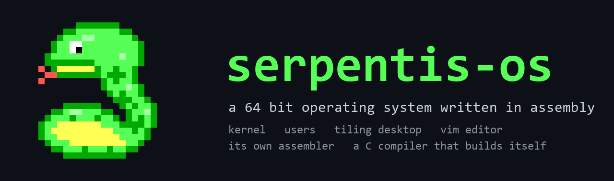
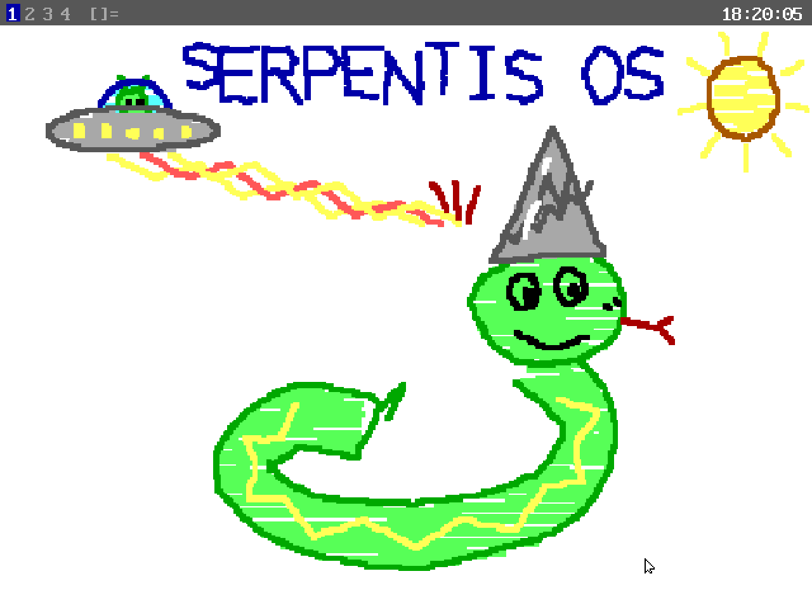

serpentis-os is a 64 bit x86 operating system written in fasm style assembly: boot sector, loader, kernel, window manager, shell, editor and the apps. It also carries apple, an assembler that runs inside the system, and cc, a C compiler derived from chibicc with a small libc. About 60k lines of asm and 8.6k lines of C (counted over *.asm and *.inc, and over compiler/ and libc/ *.c and *.h).

## what works

- boot: 512 byte boot sector, 7680 byte loader, long mode, kernel loaded from an ATA disk (build.sh checks both sizes)
- kernel: 4 level paging with one address space per process, up to 32 preemptive ring 3 processes, int 0x80 syscalls (73 numbers in include/syscall.inc), 32 pseudo terminals, pipes, shared memory and message boxes
- filesystem: own format with full path entries, owner, rwx bits and extents, ATA with DMA
- users: first boot creates a user and a root password, login and su, passwords stored as salted sha256 (sha256 is in asm)
- drivers: ATA, PS/2 keyboard and mouse with wheel, PIT, PC speaker, RTC, serial, Bochs VBE 640x480 in 256 colors
- gui: tiling window manager, 4 workspaces, floating windows, launcher
- lds: shell and terminal in one program, pipes, redirection, history
- 52 command line tools in apps/commands (grep, sort, diff, xargs, xxd and so on), more are built into the kernel shell
- apps: editor (vim style), files, calc, clock, paint, graphcalc (up to 4 formulas), snake house (small point and click game), spin3d (mesh viewer on gfx3d.inc)
- apple: x86 64 assembler, reads fasm syntax, no linker
- cc: C compiler, no linker, whole program output that apple assembles
- 20 example programs in examples/ (asm and C), 19 test programs in tests/programs

## build and run

Needs fasm, python 3 with pillow and qemu. clang is only needed for the C parts (cc, libc, C examples), without it they are skipped.

    ./build.sh
    ./run.sh

build.sh builds boot, loader, kernel and every app and writes build/serpentis-os.img (64 MB) with the source in /usr/src/serpentis. run.sh boots it in qemu, with kvm if /dev/kvm is writable. FASM, QEMU, PYTHON and CLANG_BIN override the PATH lookup. build.bat and run.bat do the same on windows.

Prebuilt image from the releases page:

    qemu-system-x86_64 -m 512M -drive file=serpentis-os.img,format=raw,if=ide -boot c

virtualbox: type Other/Unknown (64-bit), 512 MB, the disk on the IDE controller, the kernel only speaks ATA. vmware has no Bochs video registers, black screen.

## keys

    super enter         terminal
    super space         launcher
    super e f t p c d   editor, files, clock, paint, calc, demo
    super h j k l       move focus
    super 1 to 4        switch workspace
    super v             float or tile
    super q             close the window
    ctrl f              fullscreen
    ctrl l              next layout
    f10                 leave the desktop

## apple, cc, spin3d

    apple /share/models/apple.asm apple.msh
    spin3d apple.msh

apple on the editor, files, clock, graphcalc and spin3d sources gives the same bytes as fasm. compiler/README.md describes cc and its calling convention.

## layout

    boot/        boot sector and loader
    kernel/      the kernel
    include/     shared constants, syscall numbers, program format
    config.inc   memory map and hardware ports
    apps/        everything that runs in ring 3
    assembler/   apple
    compiler/    cc
    libc/        the C library
    examples/    asm and C programs copied to /src
    tests/       programs that poke at syscalls, faults, scheduling
    tools/       image builder, wallpaper and game converters, clang wrapper
    models/      meshes written as asm
    game/        drawings and scenes.json for snake house

## not done

- no networking, no CD driver (no iso), no sound beyond the PC speaker
- only ATA, only 640x480 at 256 colors
- no groups: the middle chmod digit is stored but nothing reads it
- vmware does not work

## credits

cc is built on chibicc by Rui Ueyama, MIT, see compiler/LICENSE.chibicc.
