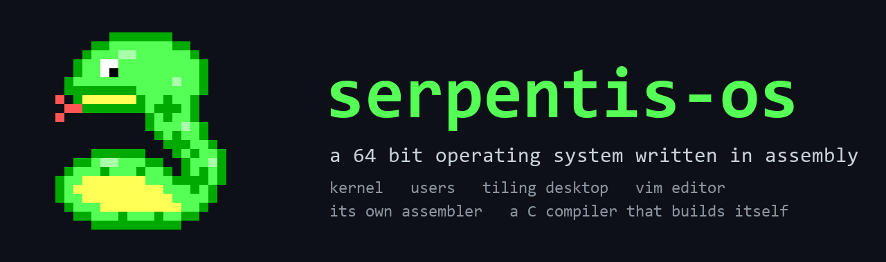

serpentis-os is a 64 bit operating system for x86 written in assembly from the boot sector up. the kernel, the window manager, the shell, the editor, the apps and the assembler are all fasm style asm. nothing underneath it, no linux, no grub, no borrowed libc. you boot it in qemu and every byte that runs is in this repo

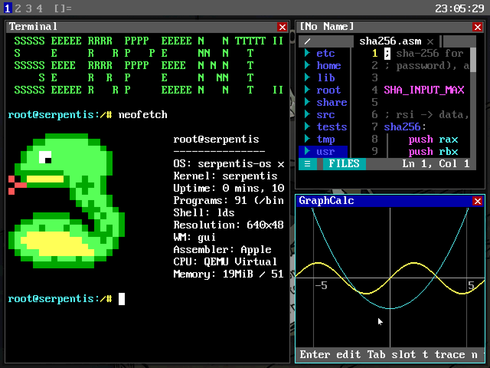

## why

i wanted one machine i can actually understand. a normal linux install is tens of millions of lines, hundreds of processes start that nobody asked for, and a good part of the drivers are closed blobs you just have to trust. windows is worse, you cant even look. i dont like running things i cant read, so i wrote something small enough to keep in my head. if something shows up on the screen i know which file put it there

## why assembly

in asm nothing is hidden. a C compiler decides a lot for you, what lives on the stack, what sits in which register, what gets optimized away. in a kernel i want to see all of that. you write mov rax, something and thats exactly what the cpu does

it sounds worse than it is. there are 16 general registers, rax rbx rcx rdx rsi rdi rbp rsp and r8 to r15, all 64 bit. you move data between memory and registers, you add, compare and jump. a function is a label you call and ret takes you back. the hard part is never the instructions, its the hardware. a pc still wakes up in 16 bit mode like its 1981 and you have to drag it to 64 bit yourself, page tables and all. get one bit wrong and the machine just resets with no message at all

## how it boots

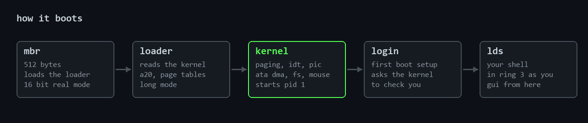

the bios loads the 512 byte boot sector, which reads the loader from the next sectors. the loader checks the cpu really has long mode, reads the kernel and a small header that says how big it is, grabs the bios 8x16 font, opens the a20 line, builds page tables for the first gigabyte and switches to protected mode and then long mode in one go

the kernel then sets up its own gdt and tss, the interrupt table, remaps the pic, starts the timer at 100 hz, finds the disk controller on pci and turns on dma, mounts the filesystem, switches the screen to the bochs framebuffer and starts pid 1, which is the login program

## the kernel

memory. 4 level paging, every process gets its own address space with its code at 4 MB, its stack under 9 MB and a heap from 1 GB up. the kernel is mapped in every one of them so a syscall never switches page tables

processes. up to 32 of them, preemptive scheduling on the timer, real ring 3, spawn wait and kill. the sse registers are saved for every process so programs can use floating point. a crashing program gets killed with the cpu exception number, the system keeps going

syscalls. int 0x80 with the number in rax and the arguments in rdi rsi rdx r10. files, directories, pipes, terminals, time, events from keyboard and mouse, shared memory and message boxes for the desktop, users and permissions

filesystem. its own format. a superblock, a table of 512 byte entries with the full path, owner, rwx bits, a timestamp and up to 32 extents per file, and a sector bitmap. changes that touch several entries are made on a copy of the table and rolled back if something fails halfway. fsck checks the whole thing, parent links, extents that overlap or point outside the disk, paths that dont match their parent

drivers. ata disk with bus master dma, ps2 keyboard and mouse including the wheel, the pit timer, the pc speaker, rtc for the clock, the bochs vbe framebuffer at 640x480 with 256 colors and palette themes

terminals and pipes. 32 pseudo terminals so a terminal window can run programs that think they talk to a real tty, kernel pipes for the shell, and per process message boxes the window manager uses to talk to apps

## users and permissions

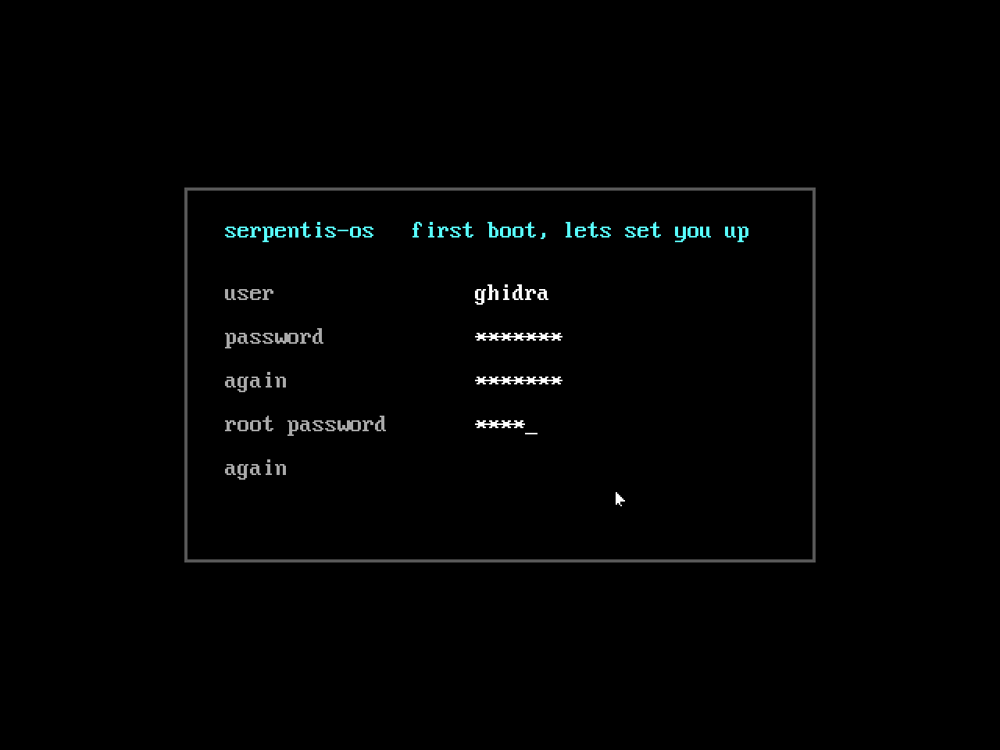

a fresh disk has no users. on the first boot you get this screen, pick a name, a password and a root password. it writes /etc/passwd, the kernel hashes the passwords into /etc/shadow, it makes your home directory and drops you at the login. from then on its the normal login every time

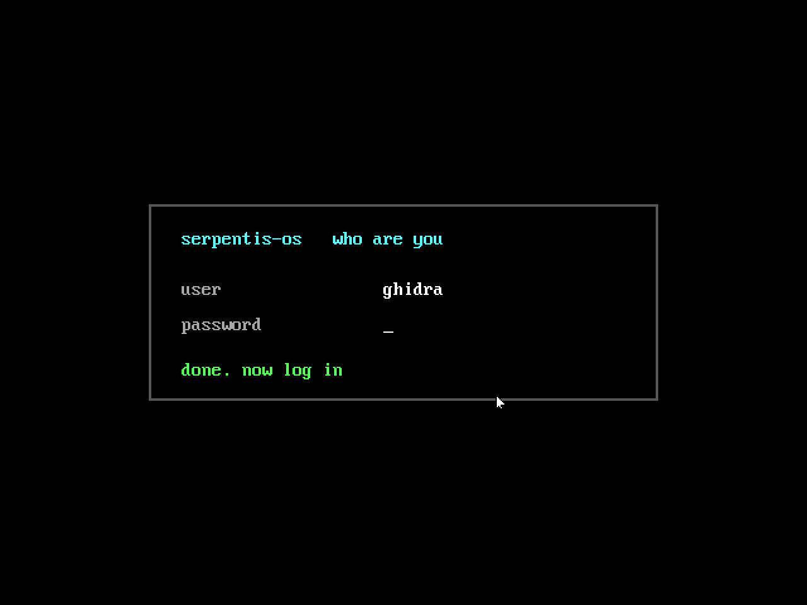

every file has an owner and rwx bits. the kernel checks them on every open, create, delete, rename, cd and program start, the commands built into the kernel go through the same checks. root walks through everything like on any unix. there are no groups, the middle digit of chmod is kept but nothing reads it

passwords are sha256 with a random salt and the sha256 itself is written in asm. only root can read the file with the hashes. the important part is that the kernel checks the password, not the program. login and su just hand it to the kernel and ask to start a program as that user, so even a broken su cant let anyone in. su, passwd, useradd, id, chmod, chown and ls -l are there

## the desktop

the window manager is called gui and it tiles like dwm. the first window takes the left side and the rest stack on the right. ctrl l switches between that, columns and rows, from 6 windows up it becomes a grid. there are 4 workspaces that slide in when you switch

any window can float. drag it by its title and it pops out of the tiling, drag a corner to resize, ctrl o pins it so it shows on every workspace, ctrl f makes it fullscreen. windows grow out of their center when they open and shrink away when they close

apps never touch the screen directly. each one draws into its own part of a shared memory block and sends a small message saying it changed, then gui copies just that window. when a window is being animated it gets scaled on the fly

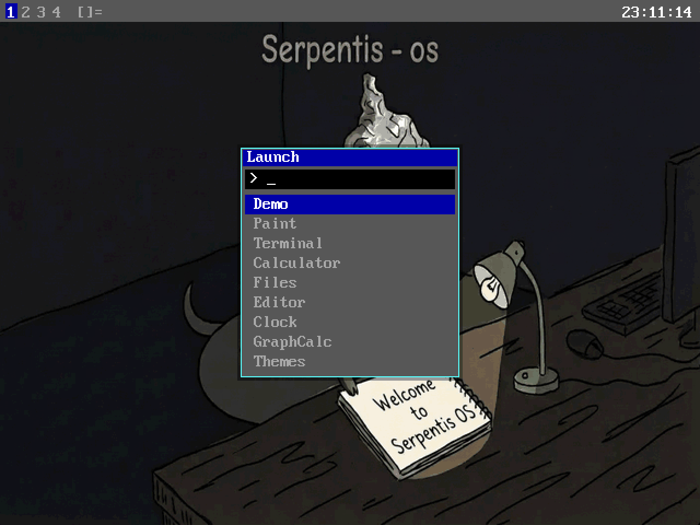

super space opens the launcher. type any part of a name and press enter

## lds, the terminal

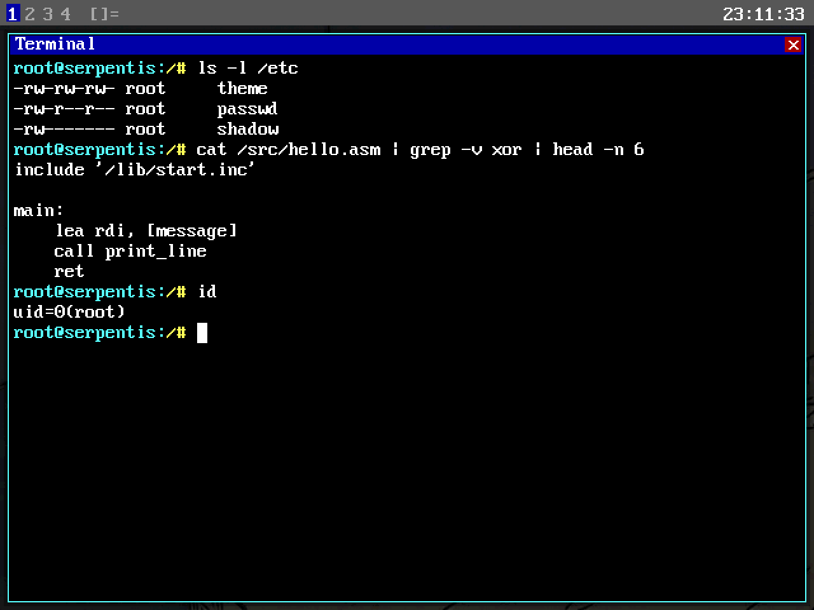

lds is the shell and the terminal in one program and its the first thing you see after login. it runs every command on its own pseudo terminal, so programs get a real tty and can tell if their output goes to a file or a pipe instead

pipes with |, redirection with < > and >>, quoted arguments, history on ctrl up and down, f1 for help. typing while a program is still running works, the keys it never read come back to your next prompt. it understands ansi color codes. the small commands like ls cd cat rm cp mv live inside the kernel and answer instantly, everything else is a program in /bin, about 45 unix tools like grep sort uniq cut tr wc diff xargs head tail tee xxd

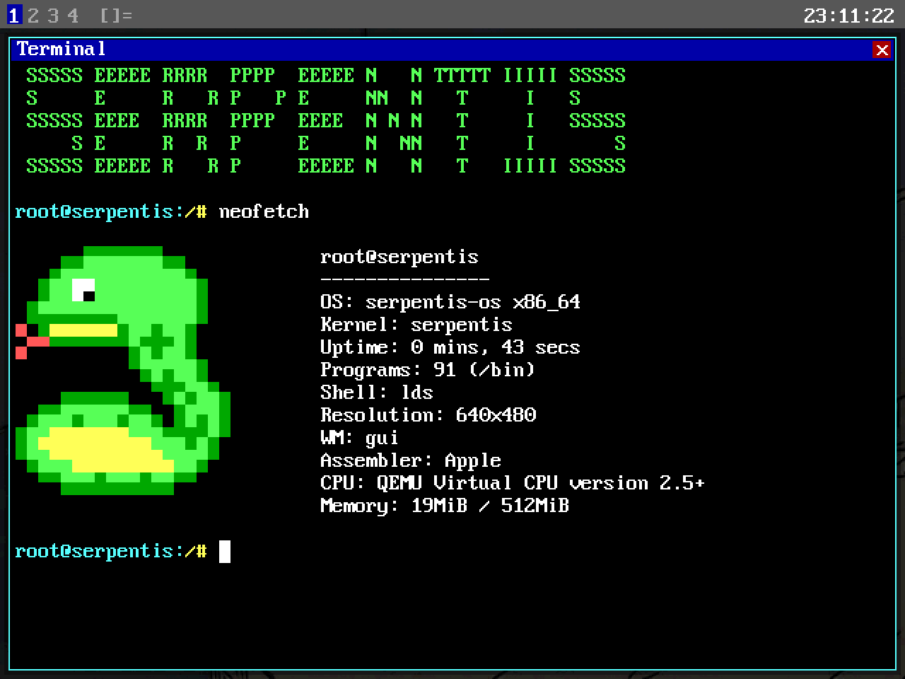

## edit

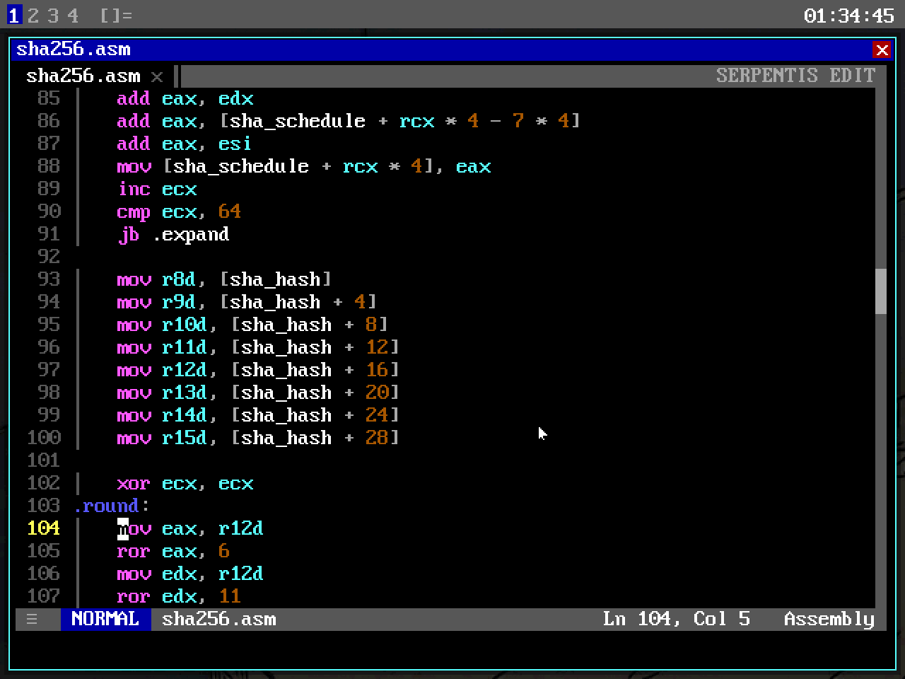

a vim style editor. normal, insert, visual and visual line mode, counts, operators with motions like dw c$ y3j, text objects like ciw da( yi", f t and their friends, search with / and ? and n, :s and :%s, undo and redo in groups so one u takes back a whole change

it keeps many files open as tabs, has a file tree on ctrl b and a fuzzy finder on ctrl p that searches the whole tree under the current directory. colors for asm and C, line numbers, indent guides, bracket matching, the mouse wheel and a scrollbar you can drag. the whole os can be edited inside it

## graphcalc

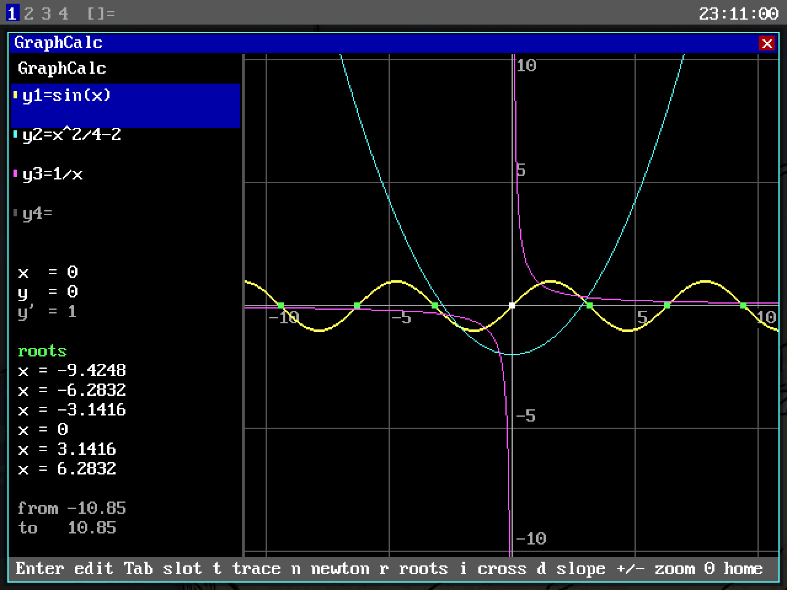

a graphing calculator, and the app i had the most fun with. up to 4 formulas at once, typed the way you would write them on paper. 2sin(3x)+|x| works, so does implicit multiplication like 3x or x(x+1), powers, and nested abs bars

each formula is parsed once into a small stack program and then run thousands of times per frame, once for every pixel column. all 23 math functions are written from scratch with sse, no x87 and no lookup tables. sin and cos reduce the angle to a quarter turn and run a taylor series, atan halves the angle twice so the series converges fast, ln splits the double into exponent and mantissa and uses a fast series on what is left, exp works through powers of two

t shows a trace line with the value and the slope. n runs newton method from the trace point and draws every step, the tangent down to the axis and the next guess, until it lands on a root. r finds every root on screen and i every point where two curves cross, both by bisection. d draws the derivative. 1/x and tan dont get fake vertical lines at the asymptotes because it checks halfway between two pixels whether the curve really is continuous there

## files

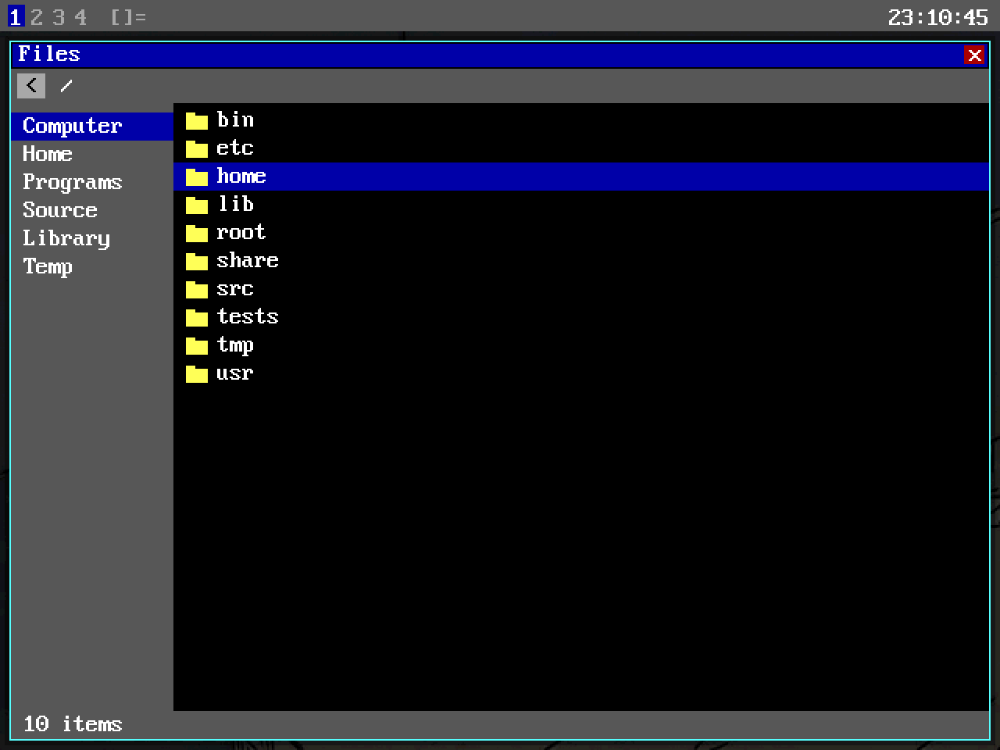

a simple file manager. places on the left, folders first in the list, double click or enter opens. folders go in, programs run, everything else opens in the editor. delete asks before it does anything

## calc, clock, paint, theme

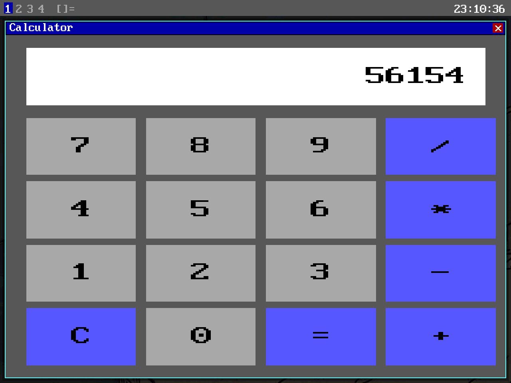

calc is a plain four function calculator for the mouse or the keyboard, 64 bit integers, left to right like the cheap ones

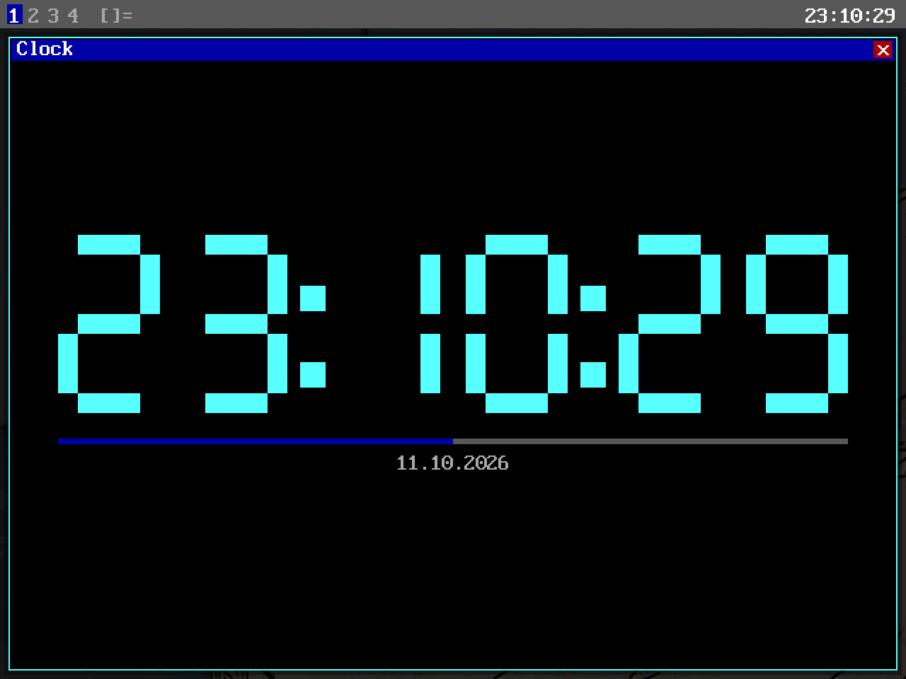

the clock draws seven segment digits out of rectangles so they scale with the window, a bar fills up during every minute and the date sits under it

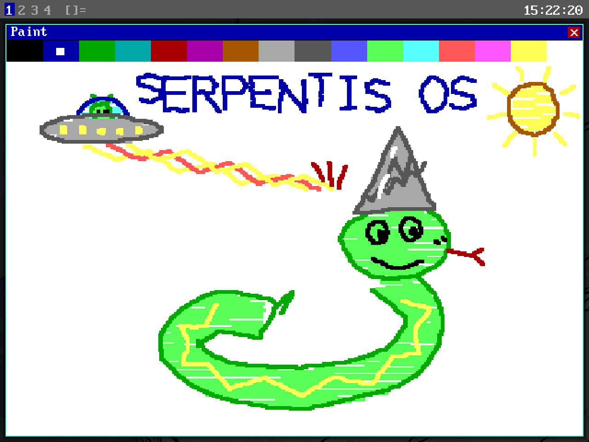

paint has the 16 colors on top and a brush. the gap between two mouse positions gets filled in so a fast stroke stays one line. the snake with the tin foil hat is drawn in it, and the same picture is the wallpaper

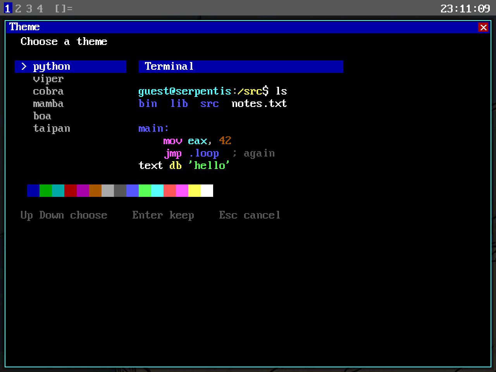

theme switches between 6 palettes named after snakes and shows a preview of a terminal and some code in each one. the choice is saved and comes back after a reboot

## apple, the assembler

apple is an x86 64 assembler that runs inside serpentis-os. it also has [its own repo](https://github.com/ghidra-devos/apple) with a longer write up. it reads fasm syntax so the same sources build on the host with fasm and inside the system with apple, which means the system can rebuild its own programs

how it works. the lexer turns a line into tokens, expressions are parsed by recursive descent with the usual precedence, symbols live in a hash table, local labels that start with a dot belong to the last normal label. macros, if else, repeat and times are handled before a line gets encoded. the encoder knows the general purpose instructions, sse and the addressing modes with rex prefixes, modrm and sib

the tricky part is jump sizes. a jump to a label 100 bytes away can be 2 bytes long or 6, and how far the label is depends on the size of every other jump in between. so apple assembles the whole file over and over, every pass using the addresses from the pass before, until nothing moves anymore, then runs one last pass that writes the file and reports errors. forward jumps are measured in the previous layout so a chain of jumps cant keep flipping between short and long

it writes the program file directly with the header filled in, so there is no linker. on the editor, files, clock and graphcalc it produces exactly the same bytes as fasm, you can check it yourself by building them inside the os and comparing

## cc, the C compiler

i didnt write the C compiler from zero. a full C front end is years of work, so i took chibicc by Rui Ueyama, a small and very readable C compiler, cut it down and made it fit this system. its MIT licensed and the license is in compiler/LICENSE.chibicc

the part that is mine is everything that touches serpentis-os. it emits fasm style assembly and runs apple on it. there is no linker, your files and the whole libc are parsed into one program and only the functions reachable from the start get written out. it has its own simple calling convention and a peephole pass that cleans up what a stack machine produces. it runs inside the os and compiles itself there. compiler/README.md has the details

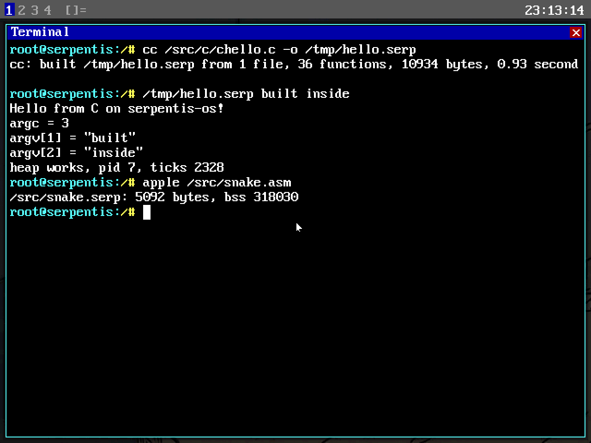

## download and try it

no need to build anything to try it. every release has the disk image ready, same 64 MB disk build.sh makes, the first boot asks for a user and the passwords and then you are in. grab it from the releases page or straight from a terminal

    curl -LO https://github.com/ghidra-devos/serpentis-os/releases/latest/download/serpentis-os.img

qemu, on windows, linux or mac

    qemu-system-x86_64 -m 512M -drive file=serpentis-os.img,format=raw,if=ide -boot c

on linux add -accel kvm and on windows -accel whpx if you have it, it boots fine without them too, just slower

virtualbox. download serpentis-os.vdi, make a new vm with type Other and version Other/Unknown (64-bit), 512 MB of memory, and when it asks for a hard disk pick use an existing disk and point it at the vdi. it has to sit on the IDE controller, the kernel only speaks ata. or all of it in one go

    VBoxManage createvm --name serpentis-os --ostype Other_64 --register
    VBoxManage modifyvm serpentis-os --memory 512
    VBoxManage storagectl serpentis-os --name IDE --add ide
    VBoxManage storageattach serpentis-os --storagectl IDE --port 0 --device 0 --type hdd --medium serpentis-os.vdi
    VBoxManage startvm serpentis-os

those two are the ones i actually run it on. vmware will boot it but its card does not have the bochs video registers the kernel uses for the screen, so expect a black screen there for now

no iso on purpose. serpentis-os boots from a hard disk, the boot sector and the loader read the kernel over ata and the filesystem lives on that same disk, there is no cd driver. the disk images are the real thing

## building and running

you need fasm, python 3 with pillow and qemu. clang is only needed for the C compiler, the C library and the C examples, without it they are skipped

    ./build.sh
    ./run.sh

build.sh builds everything and makes a 64 MB disk image with the whole system and its full source in /usr/src/serpentis. run.sh boots it in qemu, with kvm if it can. fasm, qemu and clang are taken from the PATH, or set FASM, QEMU and CLANG_BIN. build.bat and run.bat do the same on windows

## keys

    super enter         terminal
    super space         launcher
    super e f t p c d   editor, files, clock, paint, calc, demo
    super h j k l       move focus
    super 1 to 4        switch workspace
    super v             float or tile
    super q             close the window
    ctrl f              fullscreen
    ctrl o              pin to every workspace
    ctrl l              next layout
    f10                 leave the desktop

## the repo

    boot/        boot sector and loader
    kernel/      the kernel
    include/     what the kernel and programs share, syscall numbers, the program format
    config.inc   memory map and hardware ports
    apps/        everything that runs in ring 3
    assembler/   apple
    compiler/    cc
    libc/        the C library and its headers
    examples/    asm and C programs that end up in /src
    tests/       small programs that poke at the kernel, syscalls, faults, scheduling
    tools/       building the disk image and the wallpaper, clang wrapper for the C parts
    docs/        the pictures in this file
